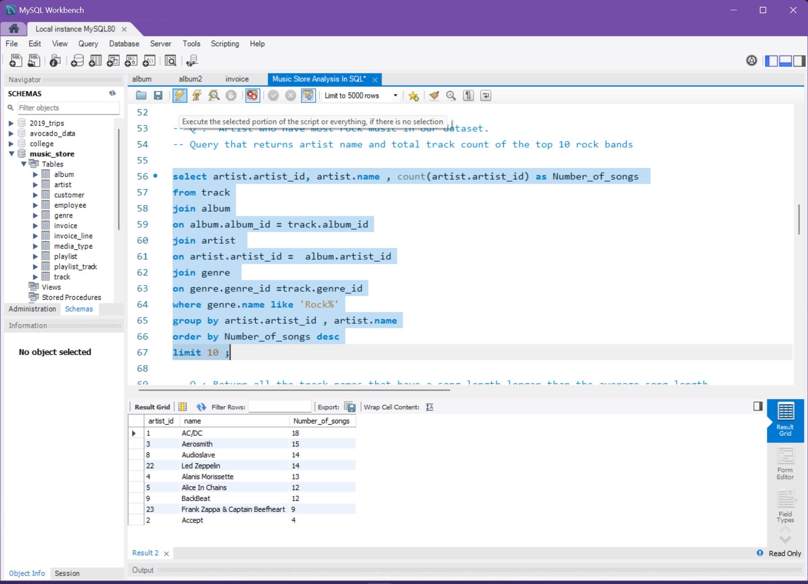

# Music Store Analysis using SQL

## About the Project
This project is about analyzing a Music Store database using MySQL to find useful business insights.

## Tools Used
- MySQL
- MySQL Workbench

## SQL Concepts
- SELECT, WHERE, ORDER BY
- GROUP BY, HAVING
- JOINS
- Subqueries
- CTEs
- Window Functions

## Analysis
Solved business-related questions about customers, sales, artists, genres, and invoices.

## Key Findings

- Identified the top-spending customers.
- Analyzed the best-selling artists.
- Found the most popular music genres.
- Compared invoice activity across countries.
- Explored customer purchasing behavior.

## Project File
- `music_store_analysis.sql`

## Project Screenshot

